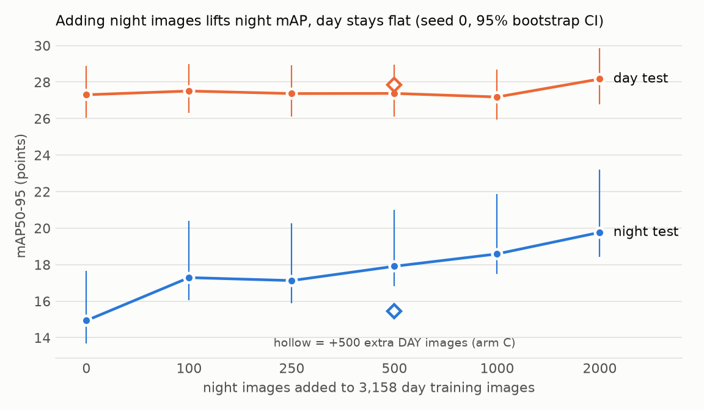

# bdd-yolo-robustness

A YOLO11s detector fine-tuned on daytime driving images loses about half its accuracy at night. This repo measures how big that drop is, whether a few hundred night images fix it better than the same number of extra day images, why the drop happens, and what TensorRT does to speed and accuracy on a laptop GPU (RTX 5050, 8 GB).

The five tests were written down in [PLAN.md](PLAN.md) before any model was trained, and they're judged exactly as written. Test 5 failed. A few things I only noticed after pre-registering are reported as sensitivity checks, and the headline numbers stay the pre-registered ones.



*Night mAP climbs as night images are added; day doesn't move. The hollow diamonds are arm C: the same 500 extra images, but daytime ones. They help day a little and night hardly at all.*

## Setup

- **Data:** BDD100K official val set, 10k images at 1280x720, every image from a different video, so no near-duplicate frames leak between splits. Pulled from the HF mirror `dgural/bdd100k` pinned at `c2e7f266` (0.70 GB), because the official BDD servers were unreachable. 10 detection classes.
- **Splits** (by a hash of the file name, fixed before training): day_train 3,158, day_extra 500, night_pool 2,329, day_test 1,300, night_test 1,300, dusk_test 778, plus 300-image day/night val sets used only for monitoring and INT8 calibration.
- **Arms**, all from COCO-pretrained `yolo11s.pt`, 40 epochs, 640 px, batch 16, scored on the **last** epoch (no checkpoint picking):
  - **A:** day_train only
  - **B:** day_train + 500 night
  - **C:** day_train + 500 extra day (same image count as B, so "more data" alone can't explain a B win)
  - **dose:** day_train + 100 / 250 / 1000 / 2000 night (500 = arm B)
- A, B and C were trained with 2 seeds each, the dose runs with one. Each run takes about 30 min on the RTX 5050.
- **Metric:** COCO mAP50-95, from my own `evaluate.py`. It matches pycocotools to 1e-6 (`selftest_eval.py`, 8/8) and adds image-bootstrap 95% CIs. When comparing two runs on the same split, the bootstrap is paired, so both runs are resampled on the same images.

## M1: how big is the night gap? (test 1: PASS)

| Model | day_test | night_test | dusk_test |
|---|---|---|---|
| COCO yolo11s, zero-shot (8 shared classes) | 23.78 | 12.03 | 17.63 |
| Arm A seed 0 (day only) | 27.30 | 14.94 | 22.33 |
| Arm A seed 1 | 27.74 | 13.88 | 22.00 |

Arm A's day-minus-night gap is **+12.37 points [+9.50, +14.50]**. The off-the-shelf COCO model shows nearly the same gap (+11.75), so night is hard for a detector before any of my training touches it. Dusk sits in between, as you'd expect.

One thing I found after pre-registering: day_test has no `train` boxes at all, so that class drops out of the day mean, while night_test has 2, which the model misses (AP 0) and which stay in the night mean. So the night number averages in one extra zero. With `train` removed from both, the gap is **+10.71 [+8.42, +12.95]**. It's smaller but still clearly there.

## M2: does night data help beyond more data? (tests 2 and 3: PASS)

| Arm | day s0 | day s1 | night s0 | night s1 |
|---|---|---|---|---|
| A: day only | 27.30 | 27.74 | 14.94 | 13.88 |
| B: + 500 night | 27.38 | 27.31 | **17.91** | **18.57** |
| C: + 500 day | 27.86 | 28.34 | 15.44 | 15.18 |

- **Test 2 PASS.** On night, B beats C by +2.93 on average over the two seeds (seed 0 +2.47 [+1.30, +3.81], seed 1 +3.39 [+2.50, +4.63], paired). The rule was that this gap must beat the spread between two seeds of the same arm, and the largest B/C spread is 0.66.
- **Test 3 PASS, but only just.** On day, B is 0.76 below C on average (seed 0 −0.48 [−1.18, +0.22], seed 1 −1.04 [−1.77, −0.29]). That's inside the 1.0-point bar, so it passes, but seed 1's CI excludes zero. Honestly, there's a small day cost; it's just under the bar I set.
- **Test 4 (descriptive), the dose curve above:** night mAP goes 14.94 → 17.29 → 17.13 → 17.91 → 18.59 → 19.77 for 0 / 100 / 250 / 500 / 1000 / 2000 night images. Half the full gain (17.35) is first reached at 500 as coded, but 100 images misses it by only 0.06, far inside the ~0.7 seed noise. Most of the first jump comes from the first 100 night images. Day stays between 27.2 and 28.2 throughout. Each dose point is a single seed.

## M3: why does night hurt?

- **It's not object size.** Day and night have almost the same mix of small / medium / large boxes (55.8 / 31.8 / 12.4% vs 54.8 / 32.2 / 13.0%), and arm A's gap shows up in every size bucket: small +5.4, medium +16.1, large +22.4 points, all with CIs above zero.
- **Traffic lights take the worst hit.** Arm A drops from 22.7 to 9.3 AP on them; arm B gets back to 14.1. At night a traffic light is a bright dot with no visible housing. Traffic signs barely drop (28.2 → 26.5), presumably because headlights make them reflect.
- **Night is less densely labelled:** 16.4 boxes per image vs 20.6 by day. Some of that is probably real (fewer pedestrians out at night), but annotators can also miss dark objects. Any correct detection of an unlabelled object counts as a false positive, so night precision numbers should be read with that in mind.

## M4: TensorRT (test 5: FAIL)

Arm B seed 0, static batch 1, 640x640. INT8 is calibrated on 300 images: day-only (from day_val), or mixed (150 day_val + 150 night_val). None of them overlap with any test image.

| Model | latency (ms, median) | p90 | day | night | dusk |
|---|---|---|---|---|---|
| PyTorch FP32 | 6.19 | 8.96 | 27.38 | 17.91 | 21.82 |
| PyTorch FP16 | 6.53 | 8.83 | | | |
| **TensorRT FP16** | **1.47** | 1.55 | 27.30 | 17.78 | 21.86 |
| TensorRT INT8, day calibration | 2.18 | 2.40 | 26.57 | 16.61 | 21.12 |
| TensorRT INT8, mixed calibration | 2.20 | 2.33 | 26.67 | 16.92 | 20.60 |

Latency is the model's own inference time over 300 runs on one image, after 50 warm-up runs. End-to-end with JPEG decoding and pre/post-processing adds about 4-5 ms to every row.

- **TensorRT FP16 is 4.2x faster than PyTorch with no accuracy loss** (within 0.13 points on every split). That's the useful result here.
- PyTorch FP16 really does run in float16 (I checked the weights' dtype), but at batch 1 eager PyTorch is bound by kernel-launch overhead, so half precision doesn't speed it up.
- **Test 5 FAIL.** The test asked whether day-calibrated INT8 loses more than 0.5 points more on night than on day. It loses 0.80 [+0.41, +1.16] on day and 1.30 [+0.75, +2.13] on night. The excess is **+0.4955** [−0.13, +1.38], just under the bar, with a CI that includes zero. So night does lose a bit more, but I can't tell that apart from no difference. Measured against the FP16 engine instead of PyTorch, which uses the same 640x640 input, the excess is +0.44.
- With mixed calibration, the night loss is 0.98 and the excess +0.28. That looks like an improvement, but since there was no established night penalty in the first place, I can't claim mixed calibration fixes anything.

### The INT8 build bug, and why INT8 is slower than FP16 here

TensorRT 10.16.1.11 couldn't build **any** INT8 engine of this network on this GPU (sm_120). Calibration runs fine, then the build dies inside TensorRT's Myelin compiler (`MyelinCheckException utils.cpp:4054 CHECK(0)` → `Could not find any implementation for node {ForeignNode[...]}`). The bisect is in [`tools/trt_diag/`](tools/trt_diag/):

- Tiny conv-only and attention-only networks build in INT8 fine.
- Cutting the real network after each block: blocks 0-5 build, and it fails from block 6 on, at the 1x1 conv right after each Concat (`m.0/cv3`, `cv2`).
- Ultralytics' own head precision settings aren't the cause. It fails without them too, and at a lower optimisation level.
- Keeping all 13 of those post-concat convs in FP16 (13 of 88 convs) makes the build work. Keeping only 2 or 4 doesn't.

So "INT8" in the table means **75 of 88 convs in INT8**, with the 13 FP16 convs pinned in [`m4.py`](m4.py), which also asserts the count. That has two effects. INT8 accuracy loss may be a little smaller than a full-INT8 engine's would be. And INT8 ends up slower than FP16, most likely because each FP16 island needs format conversions in and out. I haven't profiled that, so treat it as the likely reason, not a measured one. Calibration is Ultralytics' default MINMAX calibrator.

## Run it

```bash
make download prepare selftest selftest_eval   # data (0.70 GB) + split/label checks
make baseline                                  # M1 zero-shot COCO
make start                                     # training + eval queue in the background; run again to resume
make status
.venv/bin/python -E -s compare.py              # judges tests 1-5 -> runs/compare.json
.venv/bin/python -E -s analyze_m3.py           # M3 -> runs/m3.json
.venv/bin/python -E -s m4.py prep|export|bench|eval
```

`-E` matters if ROS is on your `PYTHONPATH`. The env is Python 3.12, torch 2.11+cu128, ultralytics 8.4.182, tensorrt-cu12 10.16.1.11.

## Files

| File | What it does |
|---|---|
| `prepare.py` | BDD JSON → YOLO labels, hash-based split lists |
| `selftest.py`, `selftest_eval.py` | split/leakage/label checks (20/20); my mAP vs pycocotools (8/8) |
| `train.py`, `queue.sh`, `Makefile` | one arm per run, resumable queue |
| `evaluate.py` | COCO mAP with per-image matches saved for bootstrapping |
| `compare.py` | judges the pre-registered tests 1-5, plus the `train`-class sensitivity check |
| `analyze_m3.py` | size and per-class breakdown |
| `m4.py`, `m4_diag.py`, `tools/trt_diag/` | TensorRT export / benchmark / eval, and the INT8 bug bisect |
| `plot_dose.py` | the figure above |
| `PLAN.md` | pre-registered tests and the full running log |
